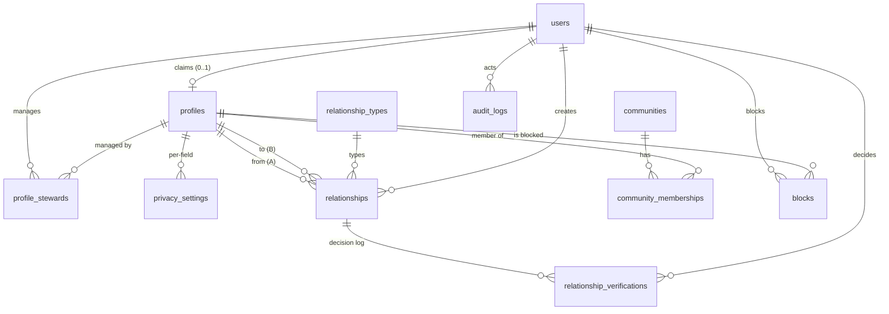

# Database Schema

PostgreSQL 16 · Prisma 5 · all changes through migrations (`apps/api/prisma/migrations`).

Legend: ✅ implemented (migration `init`) · 🗓 designed, phase noted.

## 1. Core principles

* **One person = one `profiles` row.** A profile is claimed by at most one `users` row (`profiles.user_id UNIQUE`), or
  managed by stewards (`profile_stewards`).
* **Relationships are independent of membership.** `relationships` never references `communities`; joining or leaving a
  community never creates, changes or deletes a relationship.
* **Facts, not interpretations.** Only primitive relationship facts are stored; kinship is derived (RELATIONSHIP_ENGINE.md).
* **Verification is an append-only log** (`relationship_verifications`); `relationships.status` is its computed summary.

## 2. Entity-relationship overview (implemented part)



## 3. Implemented tables ✅

### `users` — login identity
| Column | Type | Notes |
|---|---|---|
| id | uuid PK | |
| email | text UNIQUE | stored lower-case |
| password_hash | text | bcrypt (12 rounds) |
| locale | varchar(5) | `ar`/`de`/`en` |
| created_at, updated_at, deleted_at | timestamptz | soft delete for GDPR grace period |

### `profiles` — the person node
| Column | Type | Notes |
|---|---|---|
| id | uuid PK | |
| user_id | uuid UNIQUE NULL → users | NULL = managed profile |
| display_name | varchar(80) | indexed |
| full_name | varchar(160) | visible to self/family only |
| gender | enum Gender | MALE / FEMALE / UNSPECIFIED (labels only; never required) |
| birth_date, death_date | date | privacy-controlled |
| is_minor | bool | protected: never searchable, never above FAMILY visibility |
| country | char(2) | ISO 3166-1; country level only |
| city | varchar(80) | default FAMILY visibility |
| bio | varchar(1000) | |
| languages | text[] | |
| avatar_url | text | object-storage key in Phase 3 |
| searchable | bool | forced false for minors |
| created_by_id | uuid → users | |

No phone numbers or street addresses are stored in this phase (data minimisation).

### `profile_stewards`
PK (`profile_id`, `user_id`), `role` GUARDIAN (minor) / CURATOR (deceased or offline person).
Stewards speak for unclaimed profiles in verification. When a child later claims the profile, `profiles.user_id` is set
and stewards no longer confirm on their behalf (engine rule: claimed ⇒ only the owner).

### `privacy_settings`
PK (`profile_id`, `field`), `field` ∈ BIRTH_DATE, COUNTRY, CITY, BIO, LANGUAGES; `visibility` ∈ PUBLIC, NETWORK, FAMILY,
PRIVATE. Missing row ⇒ default: BIRTH_DATE FAMILY, COUNTRY PUBLIC, CITY FAMILY, BIO PUBLIC, LANGUAGES PUBLIC.

### `relationship_types` — runtime catalog
`key` PK, `category`, `directionality`, `sensitive`, `is_union`, `kinship_up`, `kinship_down`, `default_visibility`,
`labels` jsonb, `inverse_labels` jsonb, `enabled`, `sort_order`. Seeded idempotently from the engine catalog in every
environment (no demo data involved).

### `relationships` — edges
| Column | Type | Notes |
|---|---|---|
| id | uuid PK | |
| type_key | → relationship_types | |
| from_profile_id, to_profile_id | → profiles (cascade) | canonical direction (see engine) |
| status | enum | PENDING / CONFIRMED / REJECTED / DISPUTED |
| visibility | enum | PUBLIC / NETWORK / FAMILY / PRIVATE |
| created_by_id | → users | |
| parent_subtype, sibling_subtype, lineage_side | enums NULL | |
| start_date, end_date, end_reason | date / enum | unions, history of marriages |
| custom_label, custom_category | | CUSTOM type |
| note | varchar(500) | optional supporting information |
| created_at, updated_at | timestamptz | |

Indexes: `(from_profile_id, status)`, `(to_profile_id, status)`, `(type_key)` + the partial unique index below.

### `relationship_verifications` — append-only decision log
`id`, `relationship_id` (cascade), `side` A/B, `user_id`, `decision` CONFIRM/REJECT/DISPUTE, `comment`, `created_at`.
Index `(relationship_id, created_at)`, `(user_id)`.

### `communities`, `community_memberships`
`communities`: kind (FAMILY, FAMILY_BRANCH, FRIEND_GROUP, WORK, OTHER), name, description, cover_url, visibility
(PUBLIC/PRIVATE), join_policy (OPEN/APPROVAL/INVITE_ONLY), created_by_id.
`community_memberships`: PK (community_id, profile_id), role OWNER/ADMIN/MEMBER, status ACTIVE/PENDING.
*Decision ADR-7: the spec's `families` / `family_memberships` are communities of kind FAMILY / FAMILY_BRANCH.*

### `blocks`
PK (`blocker_user_id`, `blocked_profile_id`). Visibility rules hide both directions.

### `audit_logs`
bigserial id, `actor_id`, `action` (e.g. `relationship.create`, `relationship.reject`, `profile.privacy`, `block.create`,
`user.login`), `entity_type`, `entity_id`, `data` jsonb (no secrets, no private payloads), `created_at`.

## 4. Constraints beyond Prisma (migration SQL) ✅

| Constraint | Purpose |
|---|---|
| `CHECK (from_profile_id <> to_profile_id)` | no self relationships |
| `CHECK (end_date >= start_date)` | union date order |
| `CHECK (type_key <> 'CUSTOM' OR custom_label IS NOT NULL)` | custom types are labelled |
| `UNIQUE (type_key, from, to, COALESCE(custom_label,'')) WHERE status <> 'REJECTED' AND end_date IS NULL AND end_reason IS NULL` | one active copy of a fact; rejected requests and ended unions don't block new ones |
| Trigger `relationships_canonical` | symmetric types must satisfy `from < to` (uuid order) |
| Trigger `relationship_verifications_no_update` | decision log is append-only |
| Application `pg_advisory_xact_lock` per person | serialises concurrent writes touching the same people (tested: 4 parallel identical requests ⇒ exactly 1 created) |

## 5. Recursive queries

Ancestry for cycle checks and kinship uses a recursive CTE bounded to 60 generations:

```sql
WITH RECURSIVE anc(id, depth) AS (
  SELECT unnest($ids::uuid[]), 0
  UNION
  SELECT r.from_profile_id, a.depth + 1
    FROM relationships r JOIN anc a ON r.to_profile_id = a.id
   WHERE r.type_key IN ('PARENT','GRANDPARENT') AND r.status <> 'REJECTED' AND a.depth < 60)
SELECT DISTINCT id FROM anc;
```

## 6. Target schema for later phases 🗓

| Table | Phase | Key columns / notes |
|---|---|---|
| `posts` | 3 | author_profile_id, community_id NULL, body, visibility (PUBLIC/FAMILY/FRIENDS/SELECTED/PRIVATE), announcement_type (NEW_BABY, MARRIAGE, ENGAGEMENT, BIRTHDAY, REUNION, CONDOLENCES, DEATH, PERSONAL, GENERAL), sensitive_verified_at, edited_at, deleted_at; index (visibility, created_at DESC) for the public feed |
| `post_audience` | 3 | post_id, profile_id — for SELECTED PEOPLE |
| `post_media` | 3 | post_id, media_asset_id, position |
| `media_assets` | 3 | owner_profile_id, storage_key (S3), mime, size, width/height/duration, checksum, processing_status, consent flags |
| `comments` | 3 | post_id, parent_comment_id (replies), author, body, deleted_at |
| `reactions` | 3 | (post_id \| comment_id), profile_id, kind; UNIQUE per target+profile |
| `shares` | 3 | post_id, sharer_profile_id, visibility |
| `mentions`, `hashtags`, `post_hashtags` | 3 | normalised for search |
| `notifications` | 3 | recipient_user_id, kind, payload, group_key (dedupe/grouping), read_at, channel status |
| `notification_preferences` | 3 | user_id, relationship_category / tier, channel (IN_APP/PUSH/EMAIL), enabled, quiet_hours (tz, from, to), max_per_hour |
| `mutes` | 3 | user_id, muted_profile_id |
| `conversations`, `conversation_members`, `messages` | 4 | kind (DIRECT/GROUP/FAMILY/COMMUNITY); members with role, last_read_message_id; messages with ciphertext envelope (E2EE evaluation), attachments via media_assets |
| `invitations` | 4 | inviter, community_id NULL, token_hash, email_hash, qr, expires_at, accepted_by |
| `membership_requests` | 4 | community_id, profile_id, status, decided_by |
| `events`, `event_attendees` | 5 | kind (BIRTHDAY, WEDDING, ANNIVERSARY, REUNION, COMMUNITY, MEMORIAL), community_id, visibility, starts_at, location_country/city; RSVP status |
| `memories`, `memory_tags` | 5 | archive items (photo/video/audio/story/document), date precision, description; tags of people **with consent status** |
| `locations` (opt-in) | 5 | profile_id, country, city, lat/lng rounded, consent_at |
| `ai_suggestions` | 6 | kind (RELATIONSHIP, DUPLICATE, …), payload, confidence, status (SUGGESTED/ACCEPTED/DISMISSED) — never auto-applied |
| `reports` | 3 | reporter, target type/id, reason, status, moderator |
| `consents` | 1 | user_id, purpose (AI_PROCESSING, PHOTO_TAGGING, LOCATION, EMAIL), granted_at, withdrawn_at |
| `sessions` / `refresh_tokens` | 1 | hashed refresh tokens, device, revoked_at |

## 7. Demo data

`apps/api/prisma/seed.ts` loads a **fictional** network (22 people, 32 relationships, 4 communities) **only when
`NODE_ENV !== 'production'`**; the function itself throws in production. Every demo relationship's status is computed by
the engine from a realistic decision log (the seed fails if they disagree).
