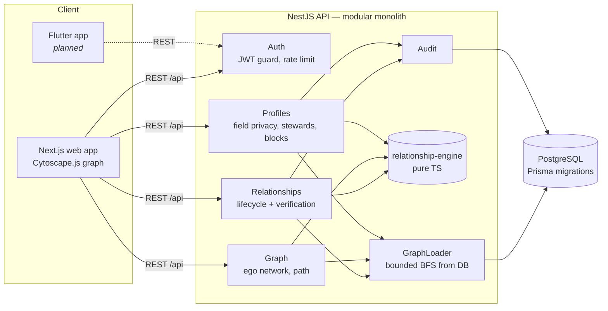

# Project Architecture — FAMILY TREE NETWORK

> Status: **Phase 1 (foundation, partial) + Phase 2 (relationship engine) prototype — working and tested.**
> Specification: [`../CLAUDE.md`](../CLAUDE.md).

## 1. Repository assessment (before this work)

| Path | What it is | Relation to this project |
|---|---|---|
| `IKTISHAFAT_AI_STUDIO/` | Separate desktop video-production app (Electron + FastAPI). | **Unrelated.** Left untouched. |
| `quote-images/` | Image assets for daily posts. | **Unrelated.** Left untouched. |
| — | No Family Tree Network code, no `CLAUDE.md` existed. | Everything below is new, in `family-tree-network/`. |

Gap against the specification at the start: 100 % — nothing existed. This document describes what was built and the
target architecture it fits into.

## 2. Architectural principles

1. **The graph is the product.** People are nodes, relationships are typed edges. No hierarchy is assumed; a family tree
   is just one *view* (the “Generations” layout) of the same graph.
2. **One person = one node.** A `profile` exists once and may be claimed by one `user` account, or managed by *stewards*
   (parents of a child, relatives curating a deceased ancestor). No duplicate person records per family or community.
3. **Store facts, derive relations.** Only primitive facts are stored (parent, sibling, union, optionally declared extended
   relations). Grandparents, uncles, cousins, in-laws, step-relations are **derived** from *confirmed* facts only.
4. **Pure engine, thin adapters.** All relationship logic lives in a framework-free TypeScript package. Database, HTTP and
   UI are replaceable adapters around it.
5. **Privacy by default.** Every read is filtered for the viewer (edge visibility, field privacy, blocks, child protection)
   *before* algorithms run, so derived results (paths, kinship, generations) never leak hidden edges.
6. **Modular monolith first.** One API process, one database. No microservices in v1 (spec §16).

## 3. Monorepo layout

```
family-tree-network/
├── CLAUDE.md                        master specification
├── docs/                            this documentation set
├── packages/
│   └── relationship-engine/         PURE TypeScript domain core (no I/O)
│       ├── src/catalog.ts           relationship type catalog, aliases, colours
│       ├── src/normalize.ts         human phrasing → canonical edge
│       ├── src/validate.ts          structural integrity rules
│       ├── src/verification.ts      two-sided verification state machine
│       ├── src/kinship.ts           kinship derivation + generations
│       ├── src/path.ts              “How Are We Connected?”
│       ├── src/visibility.ts        viewer-dependent visibility
│       ├── src/egonet.ts            ego network for progressive loading
│       ├── src/labels.ts            ar / de / en labels (incl. عم/خال distinction)
│       ├── src/notifications.ts     notification priority tiers (for Phase 3)
│       └── test/                    53 unit tests
├── apps/
│   ├── api/                         NestJS REST API + Prisma/PostgreSQL
│   │   ├── prisma/schema.prisma     schema (Phase 1–2 tables)
│   │   ├── prisma/migrations/       SQL migrations incl. constraints & triggers
│   │   ├── prisma/seed*.ts          type catalog seed + DEV-ONLY demo network
│   │   ├── src/auth/                register / login (bcrypt, JWT), global guard
│   │   ├── src/profiles/            profiles, field privacy, stewards, blocks
│   │   ├── src/relationships/       lifecycle: create / decide / update / delete
│   │   ├── src/graph/               loader (DB → engine), ego graph, path
│   │   ├── src/audit/               audit log
│   │   └── test/                    26 integration tests against PostgreSQL
│   └── web/                         Next.js 14 + Cytoscape.js
│       ├── components/GraphCanvas   interactive graph (glow, layouts, highlight)
│       ├── components/…             dashboard, panels, dialogs
│       ├── lib/i18n.tsx             ar (RTL) / de / en
│       ├── lib/layout.ts            generations layout (mirrored in RTL)
│       ├── test/                    unit tests (layout, i18n/RTL)
│       └── e2e/                     real-browser end-to-end tests
├── docker-compose.yml               local PostgreSQL
└── package.json                     npm workspaces
```

Mobile (Flutter, spec §16) is **not started**; it will consume the same REST API.

## 4. Runtime architecture



### Request flow — `GET /api/graph/ego?center=X&depth=2`

1. `JwtGuard` authenticates → `{ userId, profileId }`.
2. `GraphLoader.viewer()` loads the **viewer's** direct ties and family (4 family hops) → `ViewerContext`
   (network set, family set, blocked set).
3. `GraphLoader.neighbourhood([X], depth+1)` loads only X's neighbourhood level by level (one indexed SQL query per level),
   plus X's full ancestry via a recursive CTE.
4. `visibleIndex()` drops every edge the viewer may not see (engine `canViewEdge`).
5. Engine `egoNetwork()` + `deriveKinship()` + `generations()` run on the **visible** index only.
6. Response: nodes (public-safe summary, kinship label, generation, expand hint) and edges (category, colour, label both ways).

### Write flow — `POST /api/relationships`

1. Engine `normalizeRelationship()` turns “Layla is the MOTHER of Omar” into `PARENT layla → omar`.
2. Type enabled? Blocked? → reject early.
3. **Transaction** with `pg_advisory_xact_lock` on both people (serialises concurrent duplicates / parent-count races).
4. Engine `assertCanCreate()` — only a party or its steward may create.
5. Load both neighbourhoods + ancestry inside the transaction → engine `validateNewRelationship()`.
6. Insert relationship + creator's verification decisions; status computed by engine `computeStatus()`.
7. Audit log entry. Database constraints are the last line of defence (see DATABASE_SCHEMA.md).

## 5. Technology decisions (ADR summary)

| # | Decision | Why | Alternatives considered |
|---|---|---|---|
| ADR-1 | **PostgreSQL edge table + in-process engine**, not a graph database. | Spec mandates PostgreSQL/Prisma; relationship data is relational and must be transactional with the rest of the platform. Bounded BFS per request is cheap with the two composite indexes. | Neo4j / Apache AGE: revisit if path queries over >6 hops at large scale become a bottleneck. The engine's adapter boundary makes this swap local to `GraphLoader`. |
| ADR-2 | **Engine as a pure package** (`@ftn/relationship-engine`). | Testable without DB; reusable by the web client, workers (notifications) and a future Flutter/Dart port. | Logic inside NestJS services — rejected (couples rules to framework). |
| ADR-3 | **Canonical stored types + gendered presentation.** `PARENT` is stored; “father/mother” is a label from the profile's gender. | One fact is never stored twice; correcting a gender fixes every label. | Storing FATHER/MOTHER separately — rejected (duplication, contradictions). |
| ADR-4 | **Derived kinship, not stored.** | Uncles/cousins/in-laws are consequences of parent/sibling/union facts; storing them would drift. Declared extended edges exist only when intermediates are unknown. | Materialised kinship table — possible later as a cache. |
| ADR-5 | **Verification as append-only decision log**; status computed by the engine. | Full history, disputes, auditability. DB trigger forbids updates to the log. | Mutable status column only — rejected. |
| ADR-6 | **Stewardship for unclaimed profiles.** | Children and deceased ancestors need profiles without accounts; prevents duplicates when a child later claims the profile. | Separate “ghost person” table — rejected (two kinds of person). |
| ADR-7 | **Families are a kind of community** (`communities.kind = FAMILY / FAMILY_BRANCH / …`). | Spec lists both families and communities with identical needs (members, admins, rules, posts, events). One model avoids duplication; membership is *never* used for relationships. | Separate `families` table — would duplicate membership, invitations, requests. |
| ADR-8 | **JWT bearer tokens (12 h) in the prototype**, stored in `sessionStorage` by the web app. | Simple for the prototype. | **Must change before production:** httpOnly secure cookies + refresh rotation (see SECURITY_AND_PRIVACY.md). |
| ADR-9 | **Cytoscape.js + fcose**, custom generations layout. | Mature, canvas-based (thousands of elements), supports glow (`underlay`), styling, events. | Sigma.js (WebGL, larger graphs) — candidate for >5k visible nodes. |
| ADR-10 | **No i18n framework yet** (typed dictionary). | 3 languages, ~120 strings; compile-time key checking. | next-intl when routes/SSR translations are needed. |

## 6. Scalability path

| Concern | Prototype | Next step |
|---|---|---|
| Neighbourhood loading | One indexed query per BFS level, caps (1 500–4 000 nodes) | Cache viewer contexts (Redis); denormalised adjacency table |
| Path search | BFS on loaded neighbourhoods (≤ 8 hops) | Bidirectional BFS directly in SQL / Apache AGE |
| Kinship labels | Computed per request | Cache per (viewer, focus) with invalidation on relationship change |
| Graph rendering | Cytoscape canvas, progressive expand | WebGL renderer for very large views; server-side clustering |
| Throughput | Single NestJS process | Horizontal API replicas (stateless JWT), read replicas |

## 7. Implementation status vs. specification

See [`DEVELOPMENT_ROADMAP.md`](DEVELOPMENT_ROADMAP.md) for the detailed checklist. In short:
**Phase 2 (highest priority) is implemented end-to-end** (schema → engine → API → UI → tests). Phase 1 is partially done
(auth, profiles, permissions basics; email verification, password reset, MFA pending). Phases 3–7 are designed in the
database document but not yet implemented.
