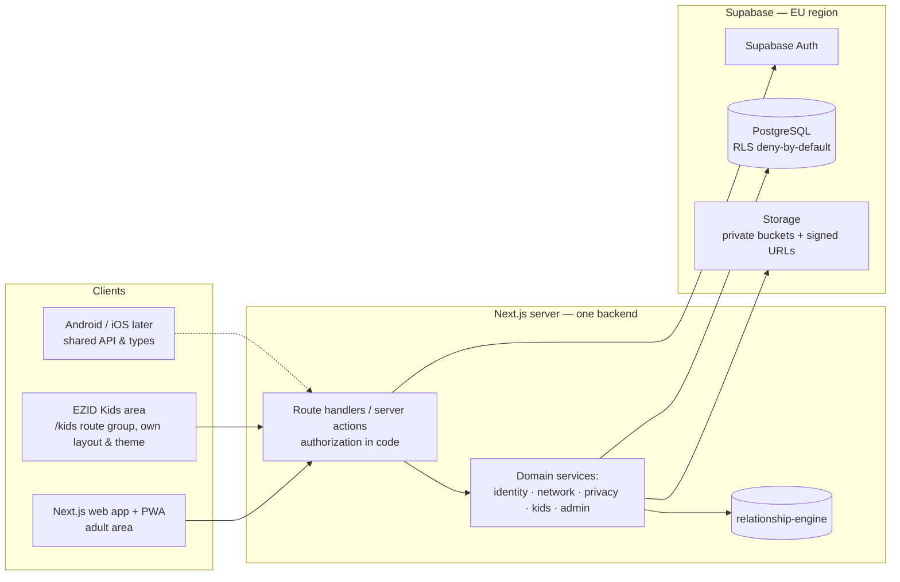

# EZIDNET — System Architecture (v1.1)

Status: **proposal for owner approval** · 2026-11-26

## 1. Starting point (inspection of the repository)
| Existing component | State | Reuse in EZIDNET |
|---|---|---|
| `packages/relationship-engine` (pure TypeScript, 53 tests) | production-quality core | **reuse 100 %** (add Kurmanji labels, Family Circles helpers) |
| `apps/api` NestJS + Prisma + own JWT auth (26 integration tests) | working | **logic reused**; framework and auth change (see §3) |
| `apps/web` Next.js + Cytoscape (12 unit + 5 e2e tests) | working | **reuse**; becomes the EZIDNET web app/PWA |
| PostgreSQL schema + migration with integrity constraints | working | **reuse**, moved to Supabase Postgres |
| Design system (tokens, fonts, contrast tests) | working | **reuse**; add Soft Gold, add separate Kids theme |
| Unrelated folders `IKTISHAFAT_AI_STUDIO/`, `quote-images/` | — | untouched |

## 2. Target architecture

* **One backend, one database** for web, PWA, Kids and future mobile apps (spec §2, §4.5).
* **Authorization stays server-side** in TypeScript using the engine (as today). Supabase **Row Level Security** is
  enabled on every table with deny-by-default as a second line of defence; browsers never query tables directly.
* **Supabase Storage** private buckets: `avatars`, `family-media`, `public-media`, `kids-content` (read-only published
  content), `identity-docs` (separate, strict — not used in the MVP).
* **EU hosting** (e.g. Frankfurt) for data protection.

## 3. Stack decision (needs approval — EZ-2)
| Option | Description | Pros | Cons |
|---|---|---|---|
| **A (recommended)** | Next.js route handlers replace the NestJS API; Supabase for Postgres, Auth, Storage; Prisma (or SQL) migrations kept | one deployable; lowest hosting cost; matches spec §2 exactly; same TypeScript everywhere | porting effort for the API (~1–2 weeks of focused work), tests ported too |
| B | Keep NestJS API; Supabase provides Postgres, Auth, Storage; NestJS verifies Supabase JWTs | least code change | two deployables, extra hosting cost, more ops for a €5k budget |

Auth migration (both options): replace the custom bcrypt/JWT login with **Supabase Auth** (email + password first;
TOTP MFA for admins; phone OTP later because SMS has per-message costs). Existing `users` table maps to `auth.users`
via `user_id`.

## 4. Module boundaries (backend domains)
identity · network (relationships, circles, requests) · privacy (audiences, field visibility, blocks) · social ·
heritage · business · creator · knowledge · services · **kids** (child profiles, consent, content, progress, settings) ·
admin (roles, audit, moderation) · ai (later, always behind human review).

## 5. EZID Kids architecture
* **Same backend and database, separate surface:** `/kids` route group with its own layout, navigation, theme and
  reduced API surface (only kids endpoints).
* **Child access without credentials (MVP of Kids):** a guardian opens "Kids mode" on their device and selects the
  child; leaving Kids mode needs the guardian's PIN. Children have no email, phone or password.
* **Future standalone app:** device pairing approved by the guardian issues a *child-scoped* token
  (`role = child`, `child_profile_id`) that RLS restricts to published kids content and the child's own progress.
  Social, messaging, search, marketplace and creator APIs reject child tokens.
* **Content pipeline:** contributors create → cultural reviewer approves → published per age group/language; only
  published, approved content is readable by children.
* **Kids AI:** server-side only, answers from the approved knowledge base, per-child guardian switch, no free web
  access, conservative logging (see `EZID_KIDS_SAFETY.md`).

## 6. Screen map
See `SCREEN_MAP.md`.

## 7. Development environment (Windows PC)
Node.js 22 LTS · Git for Windows · VS Code · either **Supabase CLI + Docker Desktop** (local stack) or a free
Supabase cloud *development* project (no Docker). All npm scripts are cross-platform (no bash-only commands).
Details in `DEPLOYMENT.md`.

## 8. Budget-aware choices (€5,000 ceiling)
| Item | Approach | Indicative cost* |
|---|---|---|
| Hosting | Supabase Pro + Vercel Pro (or similar) | roughly €45–60 / month |
| Domain | EZIDNET.COM, purchase only after approval | ~€10–20 / year |
| Transactional email | provider free tier at first | €0 at low volume |
| SMS OTP | defer; email verification first | per message, later |
| Identity verification provider | **not in MVP** (cost + risk) | per check, later |
| Legal review (DPIA, privacy policy, kids consent) | **strongly recommended before public launch** | largest single item |
| Kids content (illustrations, audio, translation) | community contributors + small budget | variable |

\* Public list prices change; verify before purchase. No purchase without owner approval.

## 9. What changes vs. FAMILY NETWORK
Brand and scope → EZIDNET · four languages incl. Kurmanji · Supabase Auth/Storage · EZID ID instead of Family ID ·
Family Circles · EZID Kids · Soft Gold accent · exclusions (§17 of the plan) · 10-phase roadmap.
Unchanged: graph architecture, engine rules, verification rules, privacy-before-algorithms, two video sections,
human-approved verification.
