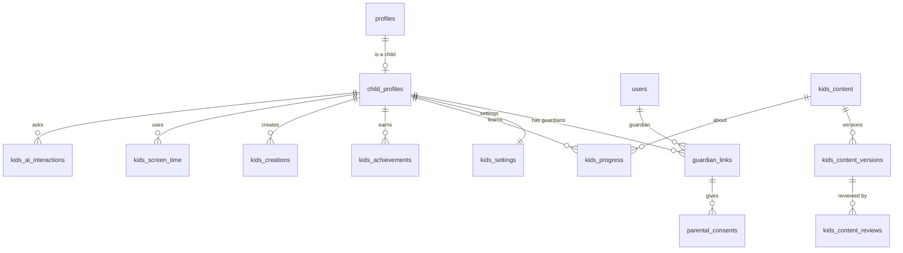

# EZIDNET — Database Plan (v1.1)

Status: **proposal for owner approval** · PostgreSQL on Supabase (EU) · all changes via migrations · existing tables
extended additively (backward compatible). Detailed description of the existing tables: `../DATABASE_SCHEMA.md`.

## 1. Principles
* One person = one `profiles` row (claimed by one account, or managed by guardians/curators).
* Relationships stored independently of communities and circles.
* **No column for religion, ethnicity or community affiliation** — membership in EZIDNET itself is sensitive; we never
  add fields that label people, and never infer them (spec §12).
* Children's data minimised: birth **year** (or age group) instead of full birth date where possible; no phone, no
  email, no precise location, no free-text public fields.
* Row Level Security on every table, deny-by-default; server code is the only writer.
* No tables for excluded features (My Digital Passport, My Proof, Project Hub, Company Directory, FN Magazine,
  My Video Archive, Friends Videos).

## 2. Existing tables (kept)
`users` (→ linked to `auth.users`), `profiles`, `profile_stewards`, `privacy_settings`, `relationship_types`,
`relationships`, `relationship_verifications`, `communities`, `community_memberships`, `blocks`, `audit_logs`.

## 3. Changes for the MVP (Phases 2–4)
| Change | Detail |
|---|---|
| `users.auth_id` | uuid UNIQUE → `auth.users.id` (Supabase Auth); `password_hash` dropped after migration |
| `user_identifiers` 🆕 | `profile_id` UNIQUE · `ezid_id` UNIQUE (format proposal `EZ-` + 8 random digits, non-sequential) · `username` UNIQUE · `created_at` |
| `qr_tokens` 🆕 | `profile_id` · `token_hash` (SHA-256 of 256-bit random token) · `kind` PERSONAL/TEMPORARY · `expires_at` · `revoked_at` · `created_at` |
| `qr_scan_events` 🆕 | `token_id` · `scanner_profile_id` · `outcome` · `created_at` (no IP stored beyond rate-limit window) |
| `relationship_requests` 🆕 | 1:1 with the pending `relationships` row · `message` · `channel` QR/SEARCH/INVITE · `state` PENDING/ACCEPTED/REJECTED/CANCELLED/REPORTED/EXPIRED |
| `relationships.status` | add `REMOVED` (soft removal with history); label "Proposed" shown for `PENDING` (spec §6 wording) |
| `relationship_history` 🆕 | append-only status/attribute changes |
| `circles` 🆕 (Family Circles) | `owner_profile_id` · `name` · `kind` FAMILY/FRIENDS/CUSTOM · audience for sharing; `circle_members` (`circle_id`, `profile_id`) — circles are **audiences**, not relationships |
| `profiles` | add `birth_year` (optional), `display_name_only` (allow pseudonymous display), `discoverable` (default **false**) |
| `consents` 🆕 | `user_id` · `purpose` (SENSITIVE_DATA_ART9, TERMS, PRIVACY, KIDS_GUARDIAN, AI, PHOTO_TAGGING) · `version` · `granted_at` · `withdrawn_at` |
| `admin_role_assignments` 🆕 | `user_id` · `role` (SUPER_ADMIN, MODERATOR, KIDS_CONTENT_REVIEWER, SUPPORT) |

## 4. EZID Kids data model (proposed, built in Phase 7)

| Table | Key columns | Notes |
|---|---|---|
| `child_profiles` | `profile_id` PK → profiles (is_minor = true) · `age_group` (A3_5, A6_8, A9_12, A13_16) · `learning_level` · `ui_languages` · `created_at` | reuses the single person record; never searchable or public |
| `guardian_links` | `child_profile_id` · `guardian_user_id` · `role` PARENT/LEGAL_GUARDIAN · `status` PENDING/ACTIVE/REVOKED · `verified_method` | a child can have several guardians; one must be ACTIVE before any activity |
| `parental_consents` | `guardian_link_id` · `scope` (ACCOUNT, PROGRESS_TRACKING, AI, VOICE, CREATIONS_STORAGE) · `version` · `granted_at` · `withdrawn_at` | each optional feature has its own consent |
| `kids_settings` | `child_profile_id` PK · `daily_minutes_limit` · `allowed_hours` · `enabled_sections` (array) · `content_requires_approval` (bool) · `ai_enabled` (default **false**) · `narration_speed` · `volume` | guardian-controlled |
| `kids_content` | `id` · `section` (LEARNING, LANGUAGES, GAMES, STORIES, CREATIVE, DISCOVERY) · `age_groups[]` · `languages[]` · `status` DRAFT/IN_REVIEW/PUBLISHED/RETIRED · `current_version_id` | |
| `kids_content_versions` | `content_id` · `body` (jsonb: text, media keys, quiz items) · `classification` (DOCUMENTED / ORAL_TRADITION / INTERPRETATION / GENERAL) · `sources` (jsonb) · `sensitivity` (NONE/MILD/REQUIRES_GUIDANCE) · `created_by` | facts vs oral tradition kept explicit |
| `kids_content_reviews` | `version_id` · `reviewer_user_id` · `decision` APPROVE/REQUEST_CHANGES/REJECT · `notes` · `created_at` | append-only; publish requires ≥ 1 cultural + 1 safety approval (proposal) |
| `kids_guardian_approvals` | `child_profile_id` · `content_id` · `approved_by` · `approved_at` | used when `content_requires_approval` |
| `kids_progress` | `child_profile_id` · `content_id` · `status` · `score` · `stars` · `completed_at` | no ranking with other children |
| `kids_achievements` | `child_profile_id` · `badge_key` · `earned_at` | badges defined in code/config |
| `kids_creations` | `child_profile_id` · `storage_key` · `kind` DRAWING/COLORING/PROJECT · `created_at` | visible to the child's guardians only |
| `kids_screen_time` | `child_profile_id` · `date` · `minutes` | aggregated per day only |
| `kids_ai_interactions` | `child_profile_id` · `question_category` · `answer_source_id` · `created_at` · **retention 30 days** (proposal) | question text stored only if guardian consented; never used for training or ads |

**Never** for children: messages, posts, follows, comments, marketplace, creator, live, public profile, map location,
QR code, people search results.

## 5. Later phases (outline)
Social (posts with audiences, messages, notifications, events), Heritage (oral history items with consent of the
speaker, historical timeline entries with source classification), Business, Creator (only `videos.section` ∈ PUBLIC,
FAMILY), Knowledge, Services — following `../FAMILY_NETWORK_MASTER_IMPLEMENTATION_PLAN.md` §7 minus excluded features.
